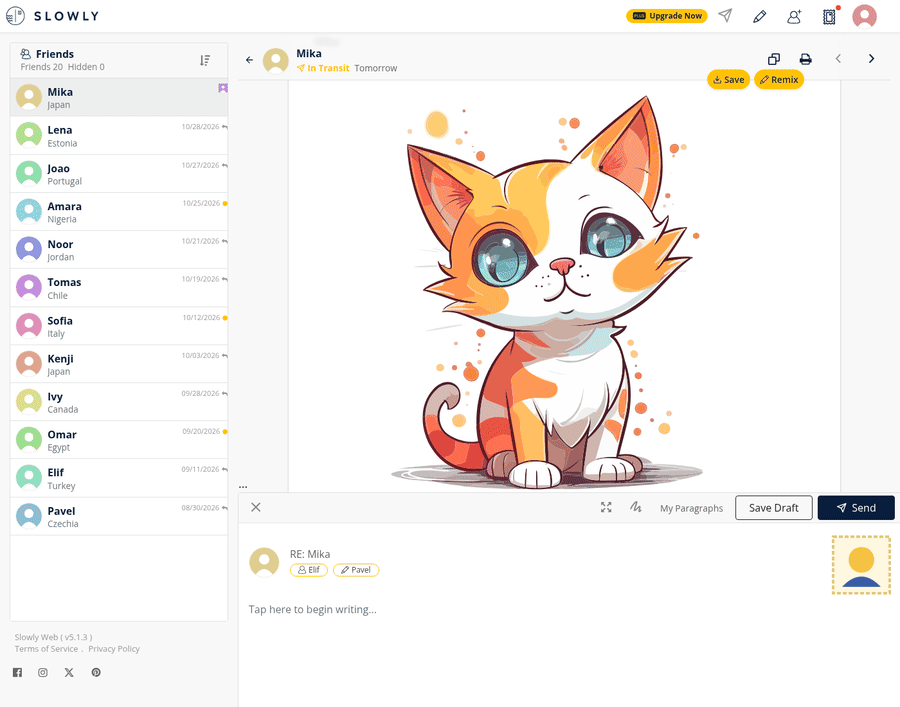
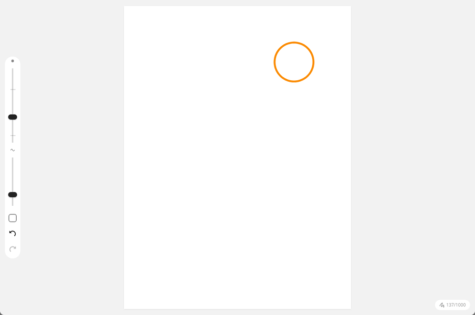
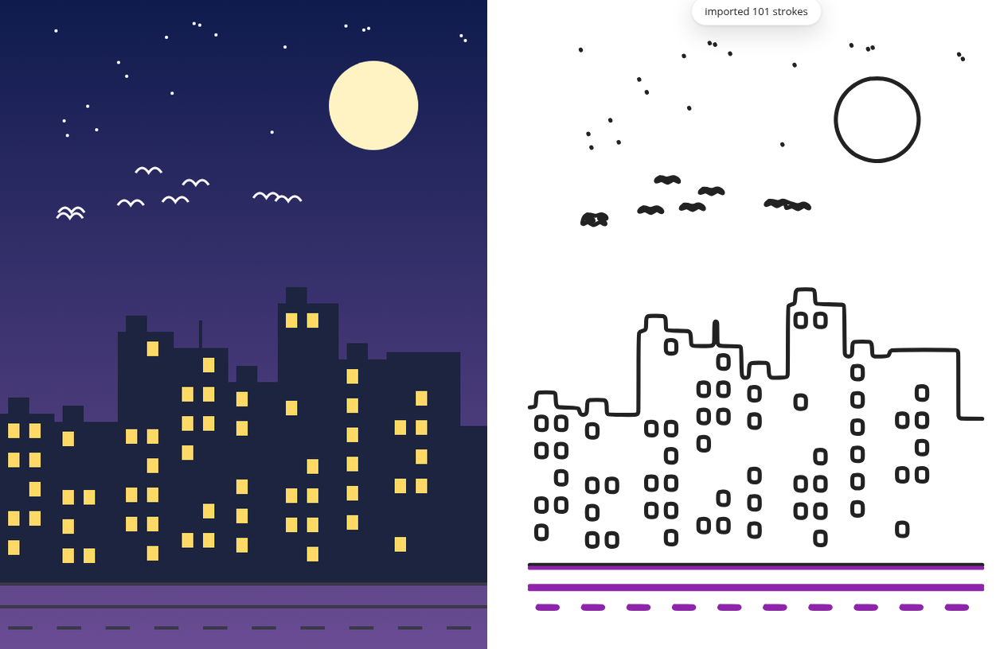
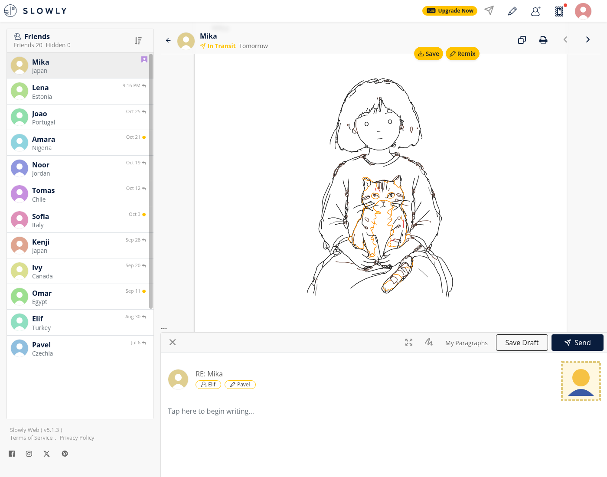
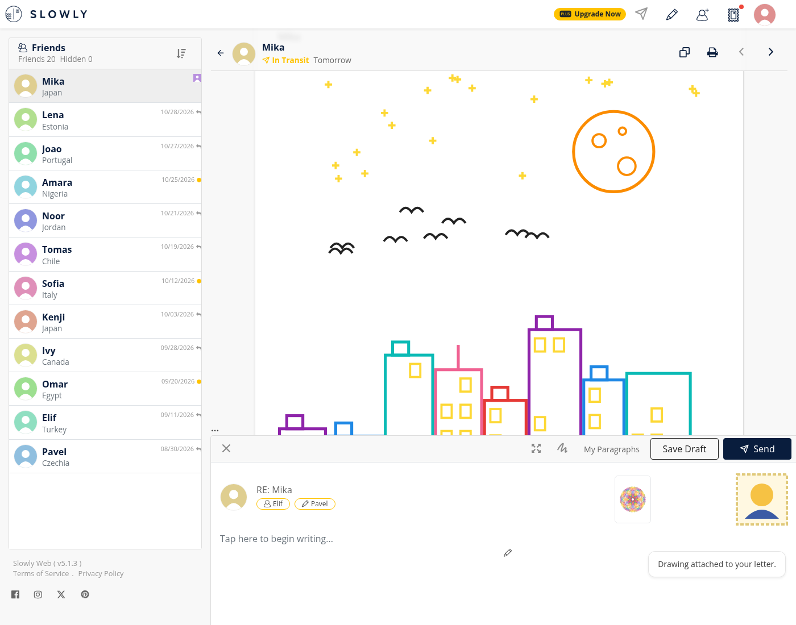
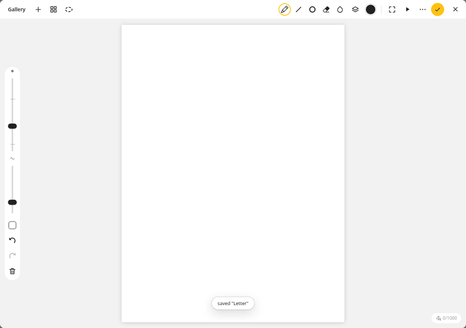
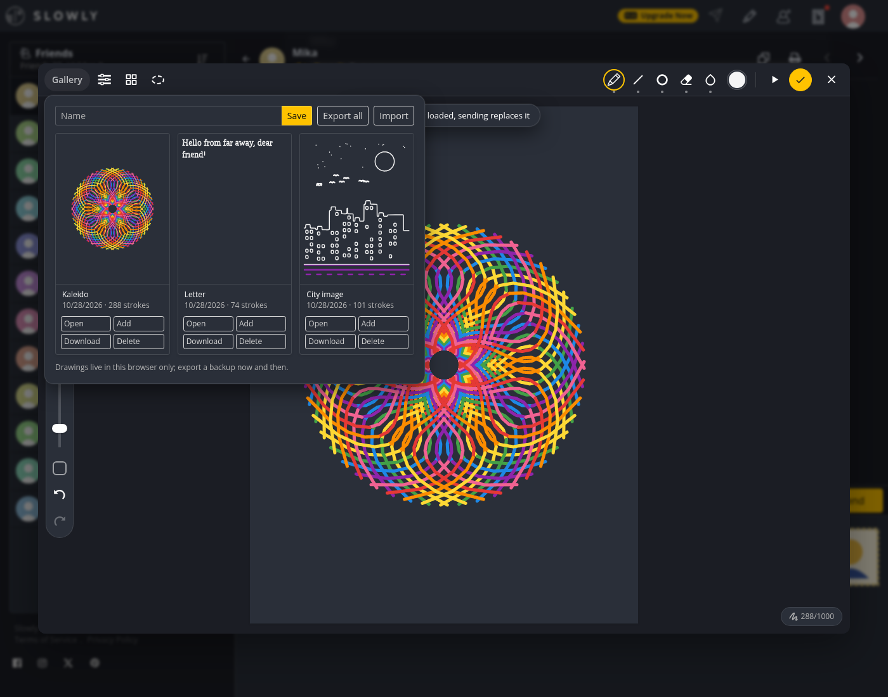

# slowly-doodler

Chrome extension for web.slowly.app. It replaces the drawing editor in the letter composer with a bigger one and puts the result back into Slowly's own editor, so the letter is sent as a normal Slowly drawing. Unofficial, not affiliated with Slowly.

Slowly's editor has 12 colors, 3 brush sizes and your finger. Doodler also takes what you already have: an SVG or any image becomes pen strokes, so you don't have to be able to draw. Text is written out as pen strokes too. For drawing by hand it adds symmetry brushes and a tracing reference. Every import ends up as ordinary strokes with a timeline, so the recipient's replay looks hand drawn.



An SVG city, 137 strokes, imported and replayed. Nobody draws that many straight windows with a finger:



An image and the line art it turns into (Photo to Line Art, edges mode):



## Install

No store listing. `chrome://extensions`, Developer mode, Load unpacked, pick `extension/`. `pnpm zip` builds `slowly-doodler.zip` from the same folder.

## Use

- Click the drawing button in the composer, or the edit button on an attached drawing. Doodler opens over the page. Shift-click opens Slowly's own editor.
- Hover a received drawing: Remix opens it in Doodler, Save puts it in the library.

  

- Send (the check mark) closes Doodler, opens Slowly's editor invisibly, restores the drawing into it, presses its Done button and attaches it to the letter.

  

- Esc closes Doodler without sending.

The top bar holds Gallery (saved drawings), Actions (add SVG, photo or text, reference image, Clear, the raw sdj, replay, shortcuts), canvas guides (symmetry, grid, snapping) and lasso select on the left, tools and colour on the right. Tap the active tool again for its options. The strip on the left has size, smoothing, the eyedropper and undo/redo. Keys: B pen, L line, O ellipse, E eraser, F fill, S select, `[` `]` weight.

By hand, with Kaleido 12 symmetry and rainbow:



Gallery in the dark theme:



Weights other than 1, 3, 6 and colors outside the 12 base ones are marked "experimental": they pass Slowly's validation but have not been checked in the mobile apps.

## How it works

`content/hook.js` runs in the page's own JS world at document start and patches `Storage.prototype.getItem`. Slowly's editor offers to restore a draft from `slowly-drawing-recovery:*` in localStorage; when Doodler has a drawing waiting under `doodler:pending`, the patched `getItem` returns it for that key once. The content script then clicks Restore and Done like a user would. No request to Slowly is forged, the page does its own upload.

`editor/sdj.js` mirrors Slowly's drawing format and limits (1000 strokes, 19999 points per stroke, 249998 in total, 32 palette entries, weight 0.5-8, canvas 720x960). `content/friends.js` recomputes Slowly's friend URL hashes (Hashids, salt `slowlyweb`) to preselect the friend whose letter is open.

The editor runs in an iframe from the extension, with Slowly's stylesheets passed in so it looks native. The library lives in extension storage (`unlimitedStorage`, large drawings are big). Permissions are `storage` and `unlimitedStorage`, host access is `https://web.slowly.app/*` only. Nothing is sent anywhere except by Slowly itself.

## What breaks

The send path depends on Slowly's markup and bundle. The selectors are in one object, `SLOWLY` in `content/content.js`. When a selector the extension expects is missing, it logs `doodler_selector_missing` and shows a toast once per session. Actions > Share still gives you the sdj to copy.

If Slowly changes the drawing format, `editor/sdj.js` and the validator copy used by the e2e test need to follow.

## Development

```
pnpm install
pnpm check        # eslint, tsc over jsconfig.json, node --test
pnpm test:e2e     # playwright, see below
pnpm shots        # regenerate docs/ images: playwright, Pillow, ffmpeg, Slowly css in unsynced/slowly/css/
```

`tests/sdj.test.js` pins the format limits and `tests/friends.test.js` pins the friend hashes. The e2e (`tests/test.py`) drives the editor in headless Chromium and checks every export against Slowly's own validator, which is not in the repo: put the `Wz` function from their `main.*.js` into `unsynced/test/wz.js`. For the `slowly` variant, also copy their `main.css` to `unsynced/slowly/css/`. Needs Python with `playwright` and its Chromium.
